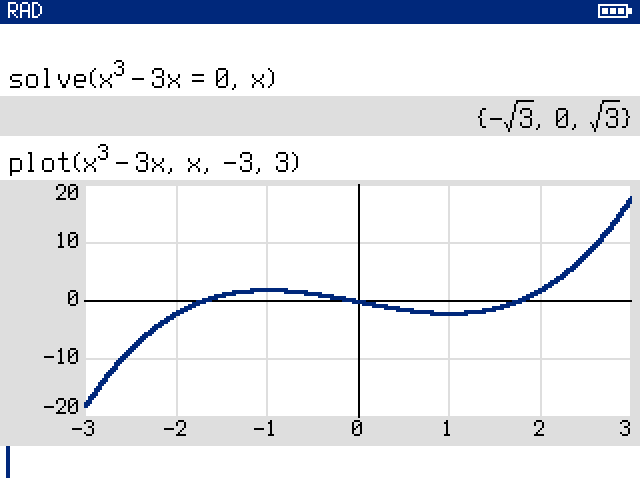
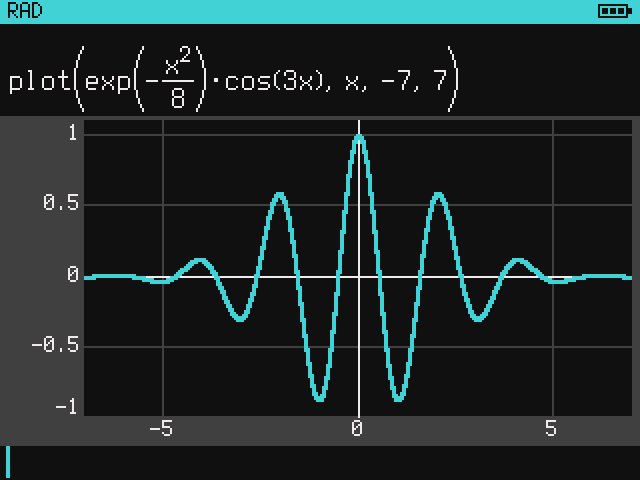
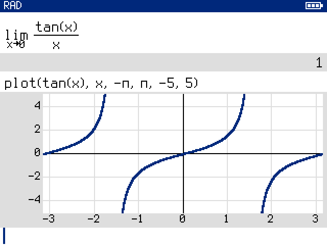
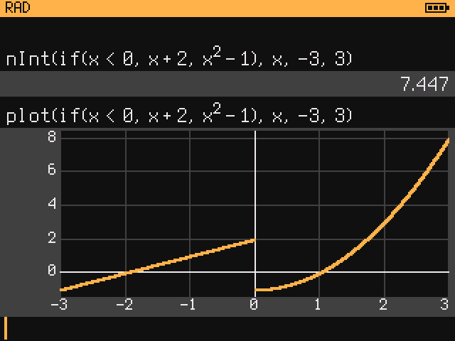
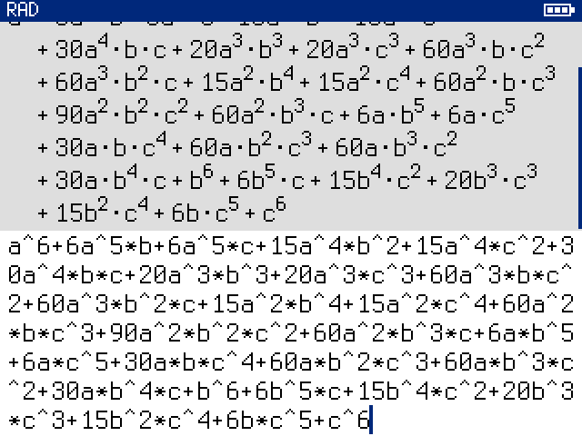
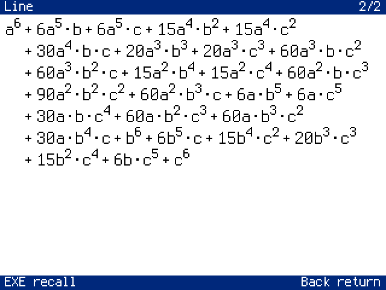

# Symmetria

A computer algebra system for the NumWorks N0100, as firmware. It takes the
place of the calculator's software: a command line in the manner of the TI-92,
exact and symbolic results typeset on the screen, graphs as answers, and help
for every function on the calculator itself.


| | |
|---|---|
| Version | 0.2 alpha, 14 October 2026 ([what is new](#new-in-02)) |
| Calculator | NumWorks N0100 only (the model number is on the back) |
| Download | [Releases](https://github.com/hugoferreira/Symmetria/releases): `symmetria-n0100-0.2-alpha.bin`, 870,716 bytes |
| SHA-256 | `2e1cbb0d7b0792c83a0aff396b028d4fbb4723f2145958b2449c8bf96b5c039c` |
| Source | not published yet: see [Source code](#source-code) |

Symmetria has no Python, no examination mode and none of Epsilon's
applications; a graph is the answer of a line, not an application. Read
[Before you install](#before-you-install).

## What it does

One expression per line; the answer is exact unless a decimal is asked for.

```
2/3 + 5/6                                3/2
expand((x + 1)^3)                        x^3+3x^2+3x+1
factor(x^4 - 1)                          (x-1)*(x+1)*(x^2+1)
factor(x^12 - 1)                         (x-1)*(x+1)*(x^2+1)*(x^2+x+1)*(x^2-x+1)*(x^4-x^2+1)
solve(x^2 - 5x + 6 = 0, x)               {2, 3}
solve([x + y = 10, x - y = 4], [x, y])   [[7, 3]]
partFrac(1/(x^2 - 1), x)                 1/(2*(x-1))-1/(2*(x+1))
d(sin(x)*exp(x), x)                      sin(x)*e^x+cos(x)*e^x
d(sqrt(x), x)                            1/(2sqrt(x))
integrate(x^2*exp(x), x)                 e^x*(x^2-2x+2)
integrate(1/(1+x^2), x, 0, inf)          pi/2
taylor(sin(x), x, 0, 5)                  x^5/120-x^3/6+x
limit(sin(x)/x, x, 0)                    1
sum(k^2, k, 1, n)                        n*(n+1)*(2n+1)/6
sum(1/k^2, k, 1, 20)                     17299975731542641/10838475198270720
deSolve(d(y, x) = y, y, x)               c*e^x
laplace(sin(t), t, s)                    1/(s^2+1)
inverse([[1,2],[3,4]])                   [[-2, 1], [3/2, -1/2]]
eigVl([[2,1],[1,2]])                     [1, 3]
charPoly([[1,2],[3,4]])                  lambda^2-5lambda-2
cSolve(x^2 + 1 = 0, x)                   {-i, i}
sin(pi/3)                                sqrt(3)/2
abs(x) | x > 0                           x
solve(x^2 - 4 = 0, x in N)               {2}
primeFactors(60)                         [[2, 2], [3, 1], [5, 1]]
nCr(33,11)*nCr(22,11)/6                  22754499243840
30!                                      265252859812191058636308480000000
[1..100000] <> (+)                       5000050000
[1..5] <~> (x -> x^2)                    [1, 4, 9, 16, 25]
#{x | 0 < x < 30, x % 3 = 0}             9
nInt(exp(-x^2), x, 0, inf)               0.8862269255
normCdf(1.96)                            0.9750021049
0.1 + 0.2                                0.3
approx(2^2000/3^1200)                    3.269532543*10^29
plot(x^3 - 3x, x, -3, 3)                 the graph, in the window -20 to 20
```

The results are given here as text; the calculator typesets them, as in the
screens below.

About 390 functions, each with a help page on the calculator (392 pages, 648
worked examples, which a page evaluates when it is opened):

- **Algebra**: `expand`, `factor`, `solve`, `cSolve`, `simult`, `partFrac`,
  `together`, `collect`, `polyGcd`, `resultant`, `groebner`, `eliminate`.
- **Calculus**: `d`, `integrate`, `limit`, `taylor`, `series`, `deSolve`,
  `rSolve`, `laplace`, `fourier`, `zTransform` and their inverses,
  `gradient`, `jacobian`, `hessian`; numeric `nInt`, `nSolve`, `nDeriv`.
- **Graphs of functions**: `plot(f, x)` or `plot(f, x, a, b)`; the answer is
  the graph, drawn in the history, and the call with its window.
- **Numbers**: integers to about 2,300 digits and fractions of them, exact;
  factorials, binomials, Fibonacci, Bell and Stirling numbers of that size.
- **Linear algebra**: `det`, `inverse`, `rref`, `lu`, `qr`, `cholesky`,
  `eigVl`, `eigVc`, `jordan`, `charPoly`, `nullSpace`, `matExp`.
- **Number theory**: primes, factorisation, `gcd`, modular inverse and powers,
  the Chinese remainder theorem, continued fractions, Stirling and Bell
  numbers.
- **Statistics**: descriptive statistics, regressions, twelve families of
  distributions, hypothesis tests and confidence intervals.
- **Assumptions**: `x^2 | x > 0`, `solve(..., x in Z)`, `given(x > 0)` for the
  session; a default domain for all variables in the settings.
- **Constraints over the integers**: `satisfy`, `allSolutions`, `nSolutions`,
  `minimize`, `maximize`, with `allDifferent`, `circuit`, `table` and other
  global constraints; set-builder notation `{x | ...}`.
- **Collections and functions**: lists, sets, ranges, lambdas
  (`x -> x^2`), map, filter and fold as operators (`<~>`, `<?>`, `<>`),
  definitions (`f(x) := ...`).
- **Graphs** as adjacency matrices: shortest paths, spanning trees, maximum
  flow, components.

| | |
|---|---|
|  |  |
|  |  |
|  |  |

The screens are drawn by the firmware's own code, run on a computer, at twice
their size. They are not photographs of the panel.

## New in 0.2

**Graphs.** `plot(f, x)` answers with the graph of `f`, drawn in the history
like any other result. There is no graph screen, trace or zoom key: the
answer is also the call with the window it was drawn in,
`plot(x^3-3x, x, -3, 3, -20, 20)`, and `↑` then `→` brings that into the line,
where the window is changed by editing its numbers. Poles and jumps are not
joined; functions in pieces (`if`, `piecewise`) are drawn, integrated and
solved numerically.

| | |
|---|---|
|  |  |
|  |  |

**Colours.** The settings choose a light or a dark screen, one of seven
accents and the height of a graph.

**Help that computes.** A help page evaluates its examples when it is opened
and typesets the results as the history would, under the settings in force.

**Long numbers.** A sum, product, quotient or integer power of numbers is one
exact number whatever its size, to about 2,300 digits: `30!`,
`sum(1/k^2, k, 1, 400)`, `(2/3)^40`. `expand` goes on past coefficients of
32 bits. Matrix functions no longer stop there either.

**Long lines.** A line holds 2,047 characters (it held 255), so a long answer
can be brought back and edited; the line scrolls in seven rows. `OK` on an
entry of the history opens its line on a page of its own.

| | |
|---|---|
|  |  |

**Answers that were wrong.** A generated check, which compares the
calculator's answers with values computed independently, found 17 classes of
wrong answer that the hand-written tests had not; all are fixed. Among them:
`nCr(30, 15)` was negative, `factor(x^15 - 1)` returned a product of degree
27, `taylor(abs(x), x, 0, 3)` was 0, `3*10^9 - 2*10^9` was 5294967296. The
[release notes](https://github.com/hugoferreira/Symmetria/releases/tag/v0.2)
list them.

**One form for a result.** `x^(-1)` and `1/x`, `(x*y)^2` and `x^2*y^2`,
`4 - i` written for `-4i`: such pairs are one term now, so their differences
are 0 and like terms join.

**Faster, and in less memory.** `factor(x^15 - 1)` takes 1.5 ms where it took
763; the determinant of an 8 by 8 matrix of numbers 1.2 ms where it took 215;
`sum(1/k^2, k, 1, 400)` 50 ms where it took 445 (estimated for the
calculator's processor). A deeply nested line that ran the stack out, and
left the calculator standing still until Reset, is now the error row
`out of memory (stack)`.

**A freeze in long sessions.** 0.1 could stand still, deaf to every key, once
a session was long enough for the history to drop its oldest entry. Found on
the calculator while this release was tested, and fixed.

## Before you install

- **N0100 only.** The image is built for the N0100's processor and board. Do
  not write it to an N0110, N0115 or N0120.
- **It replaces Epsilon.** Nothing of NumWorks' software stays, and what the
  calculator holds (scripts, settings) is lost.
- **No examination mode.** A calculator running Symmetria must not be taken to
  an examination that requires one.
- **It is an alpha.** Expect wrong answers, missing methods and rough edges.
  Do not rely on it where a mistake costs something.
- **It can be undone.** The N0100 enters its update mode by hardware (key `6`
  with Reset), whatever is installed, so other firmware can always be written
  over it: see [Going back](#going-back).

## Install

1. Download `symmetria-n0100-0.2-alpha.bin` from
   [Releases](https://github.com/hugoferreira/Symmetria/releases) and compare
   its SHA-256 with the one above (`shasum -a 256` or `sha256sum`).
2. Connect the calculator by USB. Hold `6`, press Reset on the back (a pen
   tip or a paper clip), release. The screen stays dark: the calculator is in
   DFU mode and the computer sees an "STM32 BOOTLOADER" device.
3. Write the image to the internal flash, at address `0x08000000`:

   ```
   dfu-util -d 0483:df11 -a 0 -s 0x08000000:leave -D symmetria-n0100-0.2-alpha.bin
   ```

   Without `dfu-util`: a WebUSB page such as
   [TI-Planet's for the N0100](https://ti-planet.github.io/webdfu_numworks/n0100/)
   (Chromium browsers) writes a `.bin` to the same address.
4. If the calculator does not start by itself, press Reset.

If the transfer stops with an error, put the calculator in DFU mode again and
repeat; another USB port has helped.

## Going back

Enter DFU mode as above and install other firmware. NumWorks'
[recovery procedure](https://www.numworks.com/support/handheld/rescue/)
reinstalls Epsilon; it asks for a NumWorks account.

## Using it

- Type a line, `EXE` evaluates it. Shift+`EXE` gives the decimal value.
- The printed legends keep their meaning: letters with Alpha, brackets and
  the inverse functions with Shift. While a name is typed a list of
  completions opens: `↑` `↓` choose, `EXE` takes one.
- **Toolbox**: the functions by category. **var**: your definitions, the
  assumptions in force, the last answers.
- **Help**: type `help`, or `help solve`; Shift+Back on a name opens its page.
  On a page, `↑` `↓` mark an example and `EXE` puts it into the line.
- `↑` from the line goes through the history: `EXE` brings an entry's input
  back, `→` inserts its result, `OK` opens the entry's line on a page.
- A long line scrolls in seven rows; `↑` `↓` move through its rows.
- **Home**: the settings (angle unit, what a variable is when nothing is
  stated about it, fractions or decimals, digits, the height of a graph,
  light or dark colours, the accent), the version, a diagnostics screen.
- Holding Back stops a long evaluation. The power key suspends the
  calculator and wakes it.
- `help syntax` lists the notation: `a % b`, `[1..5]`, `{x | ...}`, `#set`,
  `x -> body`, `f(x) := body`, `expr | condition`.


## What to expect of an alpha

- Settings, definitions, assumptions and the history are kept in memory only.
  They survive the power key; they are lost when the Reset key is pressed or
  the battery runs out.
- A line the evaluator has no method for comes back as entered, sometimes
  with a note in the status bar (`no method applies; try nSolve`).
- An evaluation has 158 KB of working memory; one that needs more ends with
  `out of memory`, and one nested too deeply with `out of memory (stack)`.
  `expand` stops at 255 terms. A line holds 2,047 characters. An integer has
  about 2,300 digits at most.
- A graph is of one function of one variable. The history holds 13 graphs.
- Decimals are computed in double precision and shown with up to ten digits.
- No link to a computer: USB is for power and for installing.
- Not yet checked on a calculator: the colours as the panel shows them, the
  battery reading against a meter, and stopping an evaluation with Back
  (see [How it is tested](#how-it-is-tested)).

## How it is tested

The evaluator and the screens are the firmware's own code compiled for a
computer and run by a test suite. For this release 5,921 checks on the
results of expressions and 1,545 on screens and keys pass, among them every
example of every help page. New in 0.2: 33,600 generated lines in 28 families
whose answers are judged by values computed independently (in Python, with
exact integers and 30-digit arithmetic), of which 4,096 are replayed by the
suite; 6.1 million checks of the integer and rational arithmetic against
128-bit references; the suite run once more under sanitizers; and, for 801
lines, the time, memory and stack each takes on the firmware's own code in an
emulator of the processor, compared with a recorded baseline before a change
is accepted.

A build of this release's sources with a serial port added was run on an
N0100 on 14 October 2026, driven and read over USB. 776 lines in one session
returned what the computer returns, in the time estimated for them (0.99 of
the estimate at the median of the 108 that take a millisecond or more). 29
screens were the computer's pixel for pixel but for the charging mark: graphs,
the dark screen's frame buffer, a help page, a line of 2,045 characters, the
page of a line, a history that evicted its entries thirty times, the
settings. Lines nested too deeply ended in `out of memory (stack)` and the
calculator went on.

That run found what no test on a computer had: after enough lines for the
history to drop its oldest entry, the calculator could stand still until
Reset (a table of numbers moved to an odd address, which its processor
refuses and a computer does not). It is fixed in this image, and 0.1 has it.

Not checked, because it needs eyes and hands: the colours as the panel shows
them, stopping an evaluation with Back, the battery reading against a meter.

The tests cover what was thought of and what the generators draw; a computer
algebra system can be wrong in ways that neither did.

## How it was made

Symmetria is the work of one person. It is not a fork or a port of an
existing firmware or computer algebra system, and it contains no code of
NumWorks' Epsilon, of Omega or of Upsilon. The evaluator, the solvers, the
typesetting, the interface and the hardware drivers were written for it, for
the bare processor, without a vendor library.

What came from elsewhere is listed in
[THIRD-PARTY-NOTICES.md](THIRD-PARTY-NOTICES.md): the fonts (derived from
Terminus Font), the decompressor of the help text (adapted from
zlib-deflate-nostdlib) and the mathematical routines of the compiler's
library.

What the N0100's board needs was learned from published material: the
documentation of the STM32F412 and of the display controller, and, for the
board itself, the N0100 drivers of the Omega firmware. Pin assignments, the
battery's voltage thresholds, the timing of the key matrix, the sequence that
puts the processor to sleep and the behaviour of Shift and Alpha follow what
those drivers do. They were read as a description of the hardware; the
drivers in Symmetria are separate code.

### Use of AI

Most of Symmetria's code, tests and help text were written with AI coding
assistants (Anthropic's Claude models, through Claude Code), to the author's
design and decisions. This document was drafted the same way. What stands
behind a result is what the tests and the measurements cover, as described
above, and no more than that.

## Source code

This release is the binary only. The source code is being prepared for
publication and will appear in this repository; its licence will be stated
then. Until it is there, the image cannot be rebuilt or modified by others,
and questions about how something is computed are welcome as issues.

## Reporting a problem

Open an [issue](https://github.com/hugoferreira/Symmetria/issues) with the
line as typed, what the calculator answered and what was expected. The
version is on the About screen (Home, row 8).

## Licence

The image may be installed on N0100 calculators and passed on unmodified, free
of charge: [LICENSE.md](LICENSE.md). It is provided as it is, without warranty
of any kind; installing it is at your own risk.

NumWorks is a trademark of its owner. Symmetria is an independent project,
not affiliated with, sponsored by or endorsed by NumWorks.
